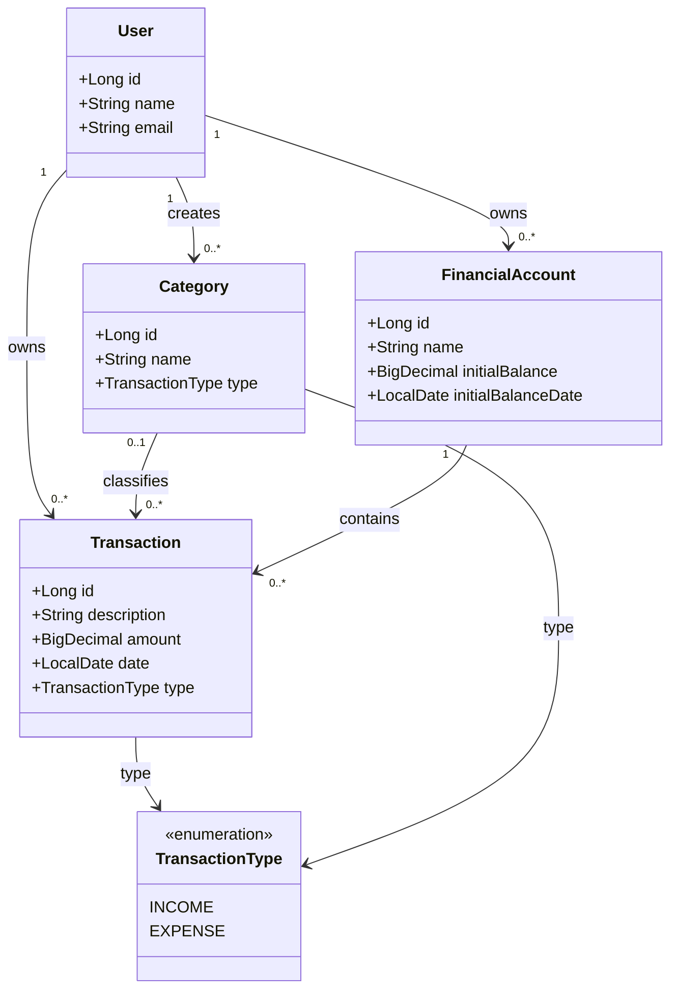

# FinTrack — Modelo de Domínio

**Versão:** 1.1  
**Status:** Em consolidação

## 1. Visão geral

O modelo de domínio representa os principais conceitos do FinTrack e seus relacionamentos.

O sistema possui quatro entidades principais:

- `User`
- `Transaction`
- `Category`
- `FinancialAccount`

Também utiliza a enumeração `TransactionType`.

## 2. Entidades

### 2.1 User

Representa um usuário cadastrado no sistema.

| Atributo | Tipo | Obrigatório | Descrição |
|---|---|---|---|
| id | Long | Sim | Identificador gerado automaticamente. |
| name | String | Sim | Nome do usuário. |
| email | String | Sim | E-mail único entre os usuários. |

### 2.2 Transaction

Representa uma receita ou despesa.

| Atributo | Tipo | Obrigatório | Descrição |
|---|---|---|---|
| id | Long | Sim | Identificador gerado automaticamente. |
| description | String | Sim | Descrição da transação. |
| amount | BigDecimal | Sim | Valor monetário positivo. |
| date | LocalDate | Sim | Data da movimentação. |
| type | TransactionType | Sim | Tipo da transação. |
| category | Category | Na criação | Categoria associada. Pode ficar ausente após exclusão da categoria. |
| financialAccount | FinancialAccount | Sim | Conta financeira associada. |
| user | User | Sim | Proprietário da transação. |

### 2.3 Category

Representa uma categoria utilizada para classificar receitas e despesas.

| Atributo | Tipo | Obrigatório | Descrição |
|---|---|---|---|
| id | Long | Sim | Identificador gerado automaticamente. |
| name | String | Sim | Nome da categoria. |
| type | TransactionType | Sim | Tipo de transação compatível. |
| user | User | Sim | Proprietário da categoria. |

### 2.4 FinancialAccount

Representa uma conta financeira pertencente ao usuário.

| Atributo | Tipo | Obrigatório | Descrição |
|---|---|---|---|
| id | Long | Sim | Identificador gerado automaticamente. |
| name | String | Sim | Nome da conta. |
| initialBalance | BigDecimal | Sim | Saldo existente na data de referência. |
| initialBalanceDate | LocalDate | Sim | Data de referência do saldo inicial. |
| user | User | Sim | Proprietário da conta. |

O saldo inicial poderá ser zero, positivo ou negativo, conforme a situação financeira representada. A aceitação de valores negativos deverá respeitar as validações definidas para o cadastro.

## 3. Enumerações

### TransactionType

Representa os tipos de movimentação financeira.

```java
public enum TransactionType {
    INCOME,
    EXPENSE
}
```

Os valores internos serão apresentados ao usuário em português:

| Valor interno | Apresentação |
|---|---|
| INCOME | Receita |
| EXPENSE | Despesa |

## 4. Relacionamentos

### User e Transaction

- Um usuário pode possuir nenhuma ou várias transações.
- Cada transação pertence a exatamente um usuário.

### User e Category

- Um usuário pode possuir nenhuma ou várias categorias.
- Cada categoria pertence a exatamente um usuário.

### User e FinancialAccount

- Um usuário pode possuir nenhuma ou várias contas financeiras.
- Cada conta pertence a exatamente um usuário.

### Category e Transaction

- Uma categoria pode classificar nenhuma ou várias transações.
- Uma transação pode possuir nenhuma ou uma categoria após sua criação.
- Na criação, a categoria é obrigatória.
- A exclusão de uma categoria não exclui as transações associadas.

### FinancialAccount e Transaction

- Uma conta financeira pode possuir nenhuma ou várias transações.
- Cada transação pertence a exatamente uma conta financeira.
- Uma conta não pode ser excluída enquanto possuir transações associadas.

## 5. Representação Mermaid



## 6. Saldo financeiro

O saldo de uma conta será calculado considerando:

- Saldo inicial.
- Receitas registradas após a data de referência.
- Despesas registradas após a data de referência.

Fórmula:

**Saldo = Saldo inicial + Receitas − Despesas**

A data de referência impede que movimentações anteriores ao saldo inicial sejam contabilizadas novamente.

O saldo consolidado do usuário poderá considerar todas as suas contas financeiras.

## 7. Observações de modelagem

- Valores monetários devem utilizar `BigDecimal`.
- Datas devem utilizar `LocalDate`.
- `TransactionType` será uma enumeração, não uma entidade.
- Os identificadores serão gerados automaticamente.
- Os relacionamentos entre entidades devem respeitar a propriedade do usuário.
- As entidades não devem depender diretamente dos mecanismos de persistência.